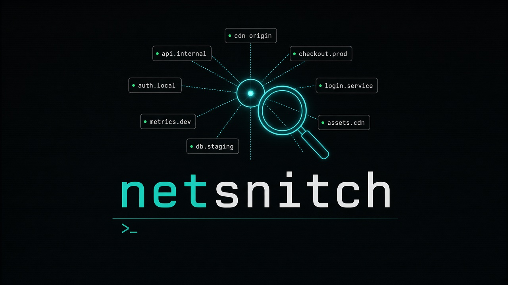

# netsnitch

See which processes phone home: a ranked table of outbound connections by domain.

Leave `netsnitch` running. It samples outbound connections, reverse-DNS resolves the remote addresses (cached), and when you stop it — or when `--duration` elapses — prints which processes talked to which domains and how often. A terminal take on the Snitch network visualizer.

## Install

Requirements, a virtualenv, platform notes, and troubleshooting are in [INSTALL.md](INSTALL.md).

```bash
python -m venv .venv
source .venv/bin/activate
pip install .
```

On Windows, activate with `.venv\Scripts\activate`.

## Run

```bash
netsnitch                  # sample until you press Ctrl-C
netsnitch --duration 60    # sample for 60 seconds, then print
netsnitch --interval 2     # check connections every 2 seconds (default: 1)
```

Hits are the number of samples in which that process was seen talking to that domain. Several sockets to the same domain in one sample count once. If reverse DNS has no name, the remote IP is shown instead.

Listing other users' sockets needs elevated permissions on Linux and macOS. `netsnitch` keeps going with what it can see and says so when something is hidden. Re-run with sudo for the full picture. If the console script is not on sudo's `PATH`, call the virtualenv binary directly:

```bash
sudo .venv/bin/netsnitch --duration 60
```

## Sample output

A 10 second run (`netsnitch --duration 10`). `python3` was holding a few HTTPS sockets open. Addresses with no reverse DNS record are shown as IPs, and the note at the top is the permission warning — re-run with sudo to attribute other users' processes too.

```
Sampling outbound connections for 10s every 1s.
Note: some processes were hidden. Re-run with sudo to see other users' processes.
                Outbound connections (10 samples)                 
┏━━━┳━━━━━━━━━┳━━━━━━━━━━━━━━━━━━━━━━━━━━━━━━━━━━━━━━━━━━━┳━━━━━━┓
┃ # ┃ Process ┃ Domain                                    ┃ Hits ┃
┡━━━╇━━━━━━━━━╇━━━━━━━━━━━━━━━━━━━━━━━━━━━━━━━━━━━━━━━━━━━╇━━━━━━┩
│ 1 │ node    │ 172.30.0.1                                │   10 │
│ 2 │ node    │ ec2-52-21-130-202.compute-1.amazonaws.com │   10 │
│ 3 │ python3 │ 104.16.123.96                             │   10 │
│ 4 │ python3 │ 172.66.147.243                            │   10 │
│ 5 │ python3 │ one.one.one.one                           │   10 │
└───┴─────────┴───────────────────────────────────────────┴──────┘
Hits = samples in which that process was seen talking to that domain.
```

## Tests

```bash
pip install -e ".[dev]"
pytest
```
